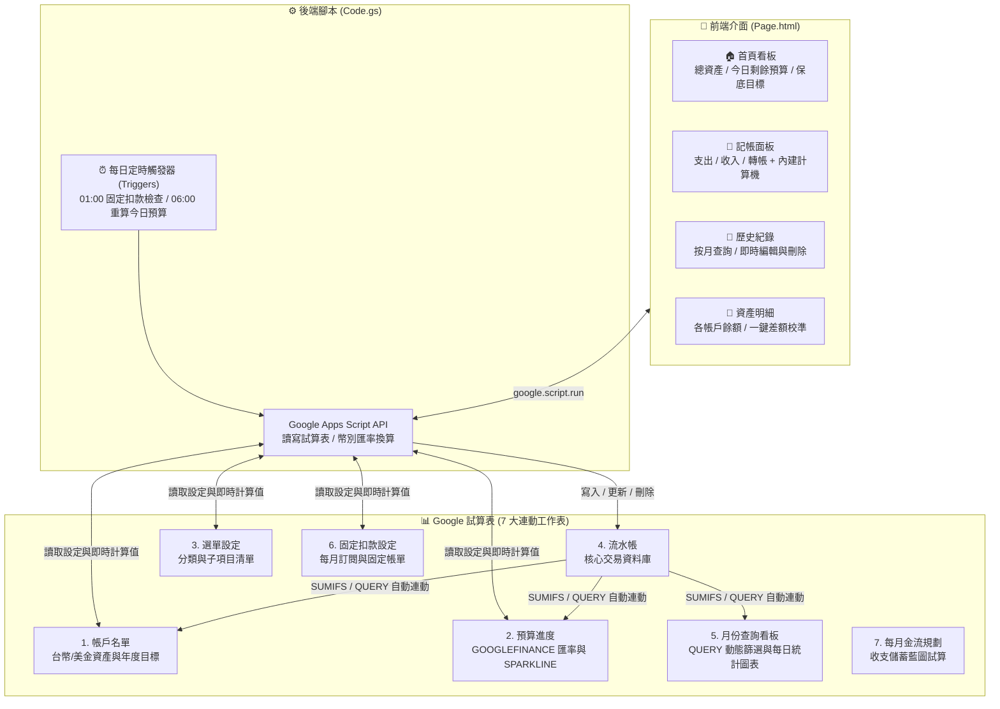

# 💰 Google Sheet 雙幣記帳與連動資產管理 App

> **零伺服器成本、100% 掌握個人財務資料主權！**  
> 結合 **Google Sheets 強大公式連動** 與 **Google Apps Script 行動版 Web App**，打造媲美原生 App 的隨手記帳、多幣別即時換算、每日動態預算控管與總資產追蹤系統。

---

## ✨ 核心功能亮點

### 1. 📱 手機 Web App ＆ 電腦側邊欄雙模式
- **手機主畫面捷徑**：支援 iOS Safari / Android Chrome「加入主畫面」，具備全螢幕 App 體驗、底部安全距離適配（Safe Area）與觸覺震動回饋。
- **電腦版試算表側邊欄**：在電腦上打開 Google 試算表，可從上方選單「💰 記帳助手」一鍵喚出右側記帳面板，邊記帳邊看大表。
- **彩虹星期主題 ＆ 即時農民曆**：首頁頂部隨星期幾自動切換專屬漸層色，底部整合即時時鐘與當日農曆宜忌。
- **隱私小眼睛模式**：預設開啟金額遮罩（`******`），在捷運或公共場所記帳不怕旁人窺視總資產。

### 2. 🌍 台幣 / 美金 / 日幣（TWD / USD / JPY）多幣別即時換算
- 試算表內建 `GOOGLEFINANCE` 自動抓取 **USD/TWD** 與 **JPY/TWD** 即時匯率。
- 在記帳介面切換 `🇺🇸 USD` 或 `🇯🇵 JPY` 時，輸入金額會**即時預覽折合台幣金額**。
- **聰明的雙欄記帳架構**：
  - **預算支出欄（E 欄）**：自動依當下匯率折算為台幣，精準計入當月台幣預算進度。
  - **帳戶原始金額欄（H 欄）**：保留原幣別金額（以及收入、轉帳金額），確保台幣與美金帳戶餘額各自精準結算、互不干擾。

### 3. 🎯 動態每日預算控管 ＆ 視覺化時間進度條
- 區分 **「一般花費」**（日常三餐、交通、生活）與 **「特支費」**（大餐、購物、娛樂、旅遊）雙軌預算。
- **每日自動重算可用額度**：系統每日早晨 6:00 自動依據 `當月剩餘預算 ÷ 本月剩餘天數` 重算「今日起始額度」，昨天不小心多花一點，今天額度自動微調，不再月底吃土！
- **試算表 `SPARKLINE` 雙色進度條**：自動比對「花費比例」與「當月時間進度（今天幾號 ÷ 本月總天數）」，一眼看出花錢速度是否超前時間進度。

### 4. 🏦 連動式資產管理、保底總資產 ＆ 一鍵餘額校準
- **多帳戶即時連動**：支援錢包、悠遊卡/ICOCA、銀行活存、交割戶、信用卡（負數代表未繳卡費）及美金外幣帳戶。
- **保底總資產（預扣專款基金）**：首頁自動計算扣除「出國旅遊基金 / 專款專用帳戶」後的真實保底總資產，並對照當月存錢目標（萬單位）。
- **一鍵餘額校準**：忘記記帳導致錢包或銀行餘額對不起來？在 App 點選「資產明細」> 點擊該帳戶金額，直接輸入「真實餘額」，系統自動計算差額並補上一筆 `餘額校準` 紀錄，不影響當月支出預算！

### 5. ⏰ 每月固定扣款自動入帳
- 在「固定扣款設定」工作表設定每月固定支出（如房租、保險、電信費、Netflix、Spotify、健身房），支援設定扣款日與啟用/停用狀態。
- 系統每日凌晨 1:00 自動檢查，若當天為扣款日且尚未入帳，即自動寫入流水帳（具備防重複鎖定機制）。

### 6. 📜 歷史紀錄查詢、修改與刪除
- 在 App 內按月份瀏覽每日收支明細，點擊任一筆卡片即可直接修改日期、項目、金額、帳戶、備註或刪除，並保留原始匯率比例不走鐘。

---

## 🏗️ 系統架構圖



---

## 📂 專案資料夾結構

```text
.
├── README.md                                  # 專案總覽與快速入門（本檔案）
├── LICENSE                                    # MIT 開源授權條款
├── docs/
│   ├── USER_MANUAL.md                         # 📖 完整圖文步驟安裝與使用手冊（強烈建議先看這篇！）
│   └── SHEET_ARCHITECTURE.md                  # 📐 試算表 7 大工作表公式與架構深度解析
├── src/
│   ├── Code.gs                                # ⚙️ Google Apps Script 後端程式碼
│   └── Page.html                              # 🎨 前端行動版 Web App / 側邊欄介面程式碼
└── template/
    └── 2026雙幣記帳與資產管理_範本.xlsx          # 📊 已去識別化、含示範資料與完整公式的試算表範本
```

---

## 🚀 5 分鐘快速開始

> 💡 **詳細圖文步驟與排錯指南請見 👉 [📖 完整使用手冊 (docs/USER_MANUAL.md)](docs/USER_MANUAL.md)**

1. **上傳並轉換試算表**  
   下載 [`template/2026雙幣記帳與資產管理_範本.xlsx`](template/2026雙幣記帳與資產管理_範本.xlsx) 上傳至您的 Google 雲端硬碟，使用 Google 試算表開啟後，點選左上角 **「檔案」>「另存為 Google 試算表」**（必須轉為原生 Google 試算表格式，才能啟用匯率公式與 Apps Script）。
2. **貼上 Apps Script 程式碼**  
   在轉換後的 Google 試算表中，點選上方選單 **「擴充功能」>「Apps Script」**：
   - 將 [`src/Code.gs`](src/Code.gs) 內容完整覆蓋貼入預設的 `程式碼.gs`（或 `Code.gs`）。
   - 點選左側「檔案」旁的 **`+` 號 >「HTML」**，命名為 **`Page`**（注意大小寫，系統會自動加上 `.html`），將 [`src/Page.html`](src/Page.html) 內容完整貼入，按 `Ctrl + S` 儲存。
3. **部署為手機 Web App ＆ 啟用定時器**  
   - 在 Apps Script 右上角點選 **「部署」>「新增部署作業」**，類型選擇 **「網頁應用程式」**，執行身分選「我」，誰可以存取選「僅限我自己」，部署後即可取得專屬手機記帳網址！
   - 回到 Google 試算表重新整理網頁，點選上方出現的 **「💰 記帳助手」>「⏰ 重新建立自動定時器」**，完成授權即可啟用每日預算重算與自動固定扣款。

---

## 📖 進階文件導覽

- 📘 **[完整安裝與使用手冊 (`docs/USER_MANUAL.md`)](docs/USER_MANUAL.md)**：從零開始的部署教學、Google 安全性授權畫面說明、iPhone/Android 加入主畫面教學、個人化設定步驟與 FAQ。
- 📐 **[試算表公式與架構解析 (`docs/SHEET_ARCHITECTURE.md`)](docs/SHEET_ARCHITECTURE.md)**：詳解 7 張工作表的欄位定義、核心公式（`SUMIFS`、`GOOGLEFINANCE`、`SPARKLINE`、`QUERY`、`MAP`）與進階客製化技巧。

---

## 📄 開源授權 (License)

本專案採用 [MIT License](LICENSE) 開源授權，歡迎自由複製、修改與分享！若覺得這個工具對您的理財與記帳有幫助，歡迎給個 ⭐ Star 支持！
